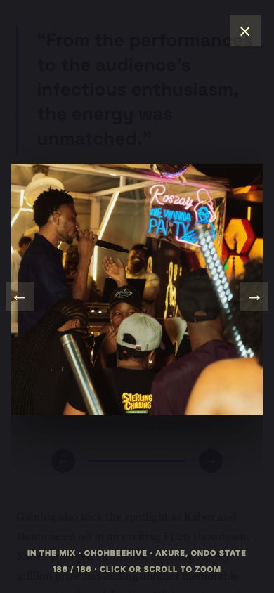

# Swerve Music website audit

Date: 7 October 2026. Scope: the local project and preview at http://localhost:4173/, a locally built production server, the site's public streaming destinations, and public DNS for its contact email domain.

Verdict: the music presentation works, but the contact and newsletter flows are not ready for launch. No application fixes, deployment, DNS changes, real emails, or successful subscriber writes were made during this audit.

## Verified results

| Check | Result |
| --- | --- |
| Default production build | Passed through `npm test` before the test assertions failed |
| Alternate build | `VINEXT_TARGET=vercel npm run build` completed locally; this is not a deployed Vercel verification |
| Production runtime smoke test | Homepage 200 with the correct title; nonexistent page 404; invalid newsletter submission 400 |
| Lint | 0 errors, 10 warnings, primarily plain image elements |
| TypeScript | Failed with 4 errors: two SQLite/Postgres mismatches in the unused D1 example, plus missing `Fetcher` and `D1Database` types |
| Automated tests | Both existing tests failed; they still assert the removed starter skeleton |
| Static assets | All 220 files returned successful local HEAD responses, including all 186 event photographs |
| Music | All seven previews loaded with 30-second durations and began playback; pause, forward skip, track selection, and automatic pausing of the other player worked |
| Streaming links | Both artist profiles and all five distinct Apple Music release links returned HTTP 200 with matching artist/release titles |
| Layout | 320, 390, 768, and 1440 px viewport checks found no page-level horizontal overflow or out-of-bounds heading text; phone menu and gallery inspected visually |
| Gallery | Accordion opens; photo viewer opens; zoom/reset work; previous from first photo wraps to photo 186; Escape closes the viewer |
| Form validation | Empty input, invalid email, missing consent, and overlong name rejected with 400; honeypot returned the intended fake success |
| Browser logs | No errors/warnings in the initial captured browser log sample |
| Dependency audit | Full tree: 30 flagged package entries, 23 high, 6 moderate, 1 low, 0 critical. `--omit=dev`: 5 entries, 4 high and 1 low. These are advisory matches, not 30 demonstrated website exploits |

## Fix before launch

### 1. Contact email delivery is disabled at the domain level

Priority: high. Evidence: live public DNS, independently checked using 1.1.1.1 and 8.8.8.8.

Both resolvers returned `swervemusic.com. IN MX 0 .`. This is a null MX record, which explicitly announces that the domain accepts no email. See [RFC 7505](https://www.rfc-editor.org/info/rfc7505/).

All three contact calls to action target this domain: artist submissions, bookings, and cultural collaborations. Clicking them can open an email app, but standards-compliant mail delivery fails under the current DNS configuration. No actual email was sent.

Action: configure a real receiving mail service and the three mailboxes/aliases, or replace the destinations with verified working addresses. Then verify actual receipt. Source: `app/page.tsx:272`.

### 2. Valid newsletter signup fails in the local preview

Priority: high. Evidence: reproduced API response plus configuration inspection.

A valid-shaped synthetic signup returned HTTP 500 and `We could not add you right now. Please try again.` The project has no local environment file and the checked shell environment has no `DATABASE_URL`. `db/index.ts` requires that variable and creates a Neon Postgres client. No subscriber was saved by the test.

The deployment instructions and `.openai/hosting.json` still describe a Cloudflare D1 binding named `DB`. The schema and SQL migration are now PostgreSQL, and `HOSTING-INSTRUCTIONS.md` names a migration file that does not exist. Provisioning the documented D1 binding does not configure the current API.

Action: decide and document the actual deployment/database path, supply the connection securely, apply the current migration, and verify persistence plus duplicate signup behavior in an isolated test database. Production database configuration was not inspected. Sources: `db/index.ts:6`, `app/api/newsletter/route.ts:41`, `HOSTING-INSTRUCTIONS.md:24`, `.openai/hosting.json`, `drizzle.config.ts`.

### 3. Newsletter lifecycle and abuse controls are incomplete

Priority: high before running a real mailing list. Evidence: source review, not a live provider test.

The implementation inserts or updates a subscriber row. There is no email provider integration, confirmation flow, unsubscribe route, or subscriber-management/export workflow in this repository, even though the form promises that visitors can unsubscribe at any time. An external provider could supply these, but no integration is present here.

Only a honeypot protects the endpoint. There is no application-level rate limit, and the duplicate-email update can change the name and force status back to `subscribed` without proof of email ownership. Edge-level protection was not checked.

Action: connect a mailing provider or implement the lifecycle, verify email ownership before activating/re-activating subscriptions, support unsubscribe and suppression, and add bounded abuse protection. Sources: `app/api/newsletter/route.ts:24`, `app/api/newsletter/route.ts:45`, `app/components/newsletter-signup.tsx:63`.

### 4. Required privacy and terms pages are absent

Priority: high under the project's own launch checklist. There are no privacy/terms pages or footer links. The site collects names, email addresses, and consent. `CLAUDE.md` expressly lists both pages as launch blockers.

Action: add owner-approved policies describing the actual business and data handling, and link the privacy notice from the signup form. This is an implementation gap against the project checklist, not a legal-compliance determination. Custom-domain status and the host's badge setting also remain unverified.

### 5. Dependency advisory findings need triage and compatible updates

Priority: high for release review. `npm audit` flags 30 package entries across the full dependency tree. The 5 entries reported with `--omit=dev` are esbuild, nanoid, postcss, source-map-js, and vite.

The full audit also flags `react-server-dom-webpack` and the vinext/tooling chain. The dev/prod package labels do not by themselves establish deployed reachability: framework packages classified as development dependencies can still contribute runtime code. Some findings concern Windows development servers, parsers, or build-time input and may not be reachable by visitors on this site.

Action: inspect dependency paths and deployment reachability, update compatible versions, rebuild, and retest. Do not blindly apply force-fixes: some suggested resolutions downgrade or change major versions of tooling. No vulnerability exploit was attempted or confirmed.

## Reproduced interaction bugs

### 6. Opening the mobile menu and resizing to desktop disables scrolling

Priority: medium. Reproduction: at 390 px, open the menu; resize to 1024 px. `.mobile-nav` becomes `display:none`, but `body.mobile-nav-open` remains and computed body overflow is `hidden`. The visible menu toggle disappears while the page remains locked.

Action: close/reset the menu when crossing the desktop breakpoint and reliably release scroll locking. Source: `app/components/mobile-nav.tsx:16`.

### 7. Sticky navigation does not remain visible

Priority: medium. Reproduction: click Music from the top. The header has computed `position:sticky`, but its rectangle is thousands of pixels above the viewport. Its ancestor `main` has `overflow:hidden`, creating the wrong scrolling context for this sticky header.

Action: revise header placement or overflow handling so navigation remains available on the long page. Sources: `app/globals.css:20`, `app/globals.css:46`.

### 8. Collapsed event content remains in keyboard navigation

Priority: medium. Reproduction: collapse the event story and press Tab from its toggle. Focus enters the hidden gallery stage. The previous/next photo buttons also remain tabbable inside `aria-hidden=true` content.

Action: make the collapsed subtree inert/hidden or unmount it, and restore focus predictably when closing. Sources: `app/components/event-story-row.tsx:47`, `app/components/coverflow-gallery.tsx:100`.

### 9. Photo viewer has incomplete keyboard accessibility

Priority: medium. Opening the viewer leaves focus on the underlying photograph. Tabbing beyond its Next photo button moves focus to Booking enquiry behind the modal. Escape closes it, but focus is not restored to the opener.

The gallery's photo buttons all use `tabIndex=-1`; the focusable stage handles arrows/Home/End but not Enter/Space to open the active photograph. A keyboard-only visitor cannot use the normal tab sequence to open it.

Action: provide a keyboard-operable opener, move focus into the viewer, contain focus while open, and restore it on close. Sources: `app/components/coverflow-gallery.tsx:41`, `app/components/coverflow-gallery.tsx:113`, `app/components/use-coverflow.ts:59`.

### 10. Mute resets when changing catalogue tracks

Priority: medium. Reproduction: mute the current catalogue track and click Next track. The new audio element is unmuted. Playback does not auto-start, but pressing Play on the new track produces sound despite the earlier mute choice.

The parent preserves volume, while `key={current.title}` remounts the player and resets its internal mute state.

Action: preserve mute alongside catalogue volume. Sources: `app/components/catalogue-coverflow.tsx:59`, `app/components/ios-music-player.tsx:81`.

### 11. Malformed newsletter payloads are reported as server failures

Priority: low. Sending JSON `null` or malformed JSON `{` returns HTTP 500. Empty valid JSON objects correctly return 400.

Action: validate the parsed body shape and return 400 for parse/shape errors; reserve 500 for server/storage failures. Sources: `app/api/newsletter/route.ts:17`, `app/api/newsletter/route.ts:59`.

## Confirmed implementation gaps and recommended improvements

### 12. Three culture rows and three social names are nonfunctional

Sound, Movement, and City stories use arrow styling but are plain articles with no link or expansion behavior. Instagram, TikTok, and YouTube in the footer are plain spans.

Action: add real destinations and approved story content, or remove the misleading arrows/social names until ready. Do not invent profiles or articles. Sources: `app/page.tsx:221`, `app/page.tsx:281`.

### 13. Artist carousel has no pause and ignores reduced-motion preference

Its interval changes the photograph every 6.5 seconds indefinitely. There is no pause button, pause on focus/hover, reduced-motion check, or hidden-tab pause in the component. Manual selection can be replaced by the next scheduled tick almost immediately.

Action: add pause/resume and respect reduced-motion preferences. Artist dots measure 30 by 4 px and inactive catalogue dots 6 by 6 px, making direct touch selection difficult; enlarge their hit areas. Source: `app/components/artist-photo-slider.tsx:16`, `app/globals.css:260`.

### 14. Most page content is hidden until JavaScript reveals it

Source-reviewed resilience problem: `[data-reveal]` starts at opacity 0, and a client effect adds visibility. If hydration or a required script fails, major server-rendered content remains invisible for users without reduced-motion enabled.

Action: make content visible by default and enable reveal effects only after client initialization. This failure mode was established from source, not by disabling JavaScript in every browser. Sources: `app/globals.css:33`, `app/components/scroll-reveal.tsx`.

### 15. Automated checks do not protect the implemented site

Both tests target `app/_sites-preview/SkeletonPreview.tsx` and starter copy that no longer exist. Type checking fails in the old D1 examples and Worker types, while the normal build still succeeds.

Action: replace the starter assertions with real homepage/media/navigation/newsletter checks; exclude or repair obsolete examples; supply correct Worker types; run type checking in the release workflow. Sources: `tests/rendered-html.test.mjs:31`, `tests/rendered-html.test.mjs:50`, `examples/d1/app/api/notes/route.ts:23`, `worker/index.ts:6`, `tsconfig.json`.

### 16. Search and link previews lack finishing work

The page has a title, description, language, viewport, and real favicon declarations. It has no canonical URL, Open Graph/Twitter image metadata, or structured artist/organization data. `/robots.txt` and `/sitemap.xml` return 404 locally; their absence alone does not prevent indexing.

Action: add metadata and discovery files once the canonical production domain is verified. Source: `app/layout.tsx:4`.

### 17. Media delivery and unused assets can be improved

All five artist photographs are rendered eagerly without responsive sources and total approximately 2.0 MB. The full public asset collection is 76.3 MiB, mostly the event album; this is not the initial page-download size. The gallery already limits rendered photographs and uses lazy loading.

Action: serve appropriately sized image variants, lazy-load off-screen artist images, and measure production transfer sizes/Core Web Vitals on a real mobile connection. No Lighthouse score or field performance metric is claimed.

Two superseded Burst Down preview files remain publicly served although the UI uses v3. Other unreferenced assets include artist-spotlight.png, culture-feature.png, live-booking.png, release-template.png, and starter file/globe/window SVGs. Consider removing them from deployment after confirming they are not needed by external links or another consumer. Nothing was deleted from public assets.

### 18. Visitor copy exposes production language

`7 supplied masters` and `Seven supplied masters, presented as 30-second website previews...` read like project handoff notes. The marquee promises `New Music Weekly`, which is not substantiated by a release schedule in this repository. Event photo captions repeat seven generic labels across 186 photos rather than describing each image.

Action: replace production terminology with owner-approved listener-facing copy, verify the weekly-release promise, and use accurate captions or neutral numbering. The README also says the artist slider contains seven photographs, while the implementation contains five. Sources: `app/page.tsx:167`, `app/page.tsx:212`, `app/components/marquee-ticker.tsx:1`, `app/components/event-story-row.tsx:8`, `README.md`.

### 19. Form and playback error recovery need improvement

Newsletter validation returns a general status message but does not mark the invalid field with `aria-invalid`, associate the message with that field, or focus it. The request has no explicit timeout/cancel path. Audio playback errors are silently caught without explaining the failure or offering recovery. These are source-reviewed gaps; a prolonged network outage was not simulated.

Action: add field-specific feedback, a bounded request timeout/retry state, and visible audio loading/error states. Sources: `app/components/newsletter-signup.tsx:17`, `app/components/newsletter-signup.tsx:50`, `app/components/ios-music-player.tsx:104`.

## Add, remove, implement

- First: repair contact email delivery; connect newsletter storage; implement mailing/unsubscribe behavior; add approved privacy and terms pages.
- Next: correct mobile scroll locking, sticky navigation, gallery keyboard behavior, mute persistence, and slider pause controls. Repair test/typecheck coverage and triage dependency advisories.
- Complete or remove unfinished story/social destinations and unsupported marketing promises. Remove obsolete examples, starter tests, and superseded public assets only after replacement/usage checks.
- Then: add sharing/search metadata, responsive images, accessible form feedback, and useful operational error reporting. A booking form and downloadable press kit would improve enquiries, but are optional additions, not confirmed defects. All existing booking links are mailto links; there is no web enquiry submission system.

## Coverage limits

This is a broad local functional and code audit, not a guarantee that every bug has been found. The deployed domain, production database, actual mail receipt, host-added security headers/badges, successful real subscription lifecycle, screen-reader experience, physical iOS/Android devices, multi-browser compatibility, production load, and field performance remain unverified. No DNS or account configuration was changed. The temporary production smoke-test server was stopped; the original preview was restored and left open.

## Screenshot

Mobile event viewer during testing. Opening, last-photo wrapping, and image display worked; keyboard focus management still needs correction.

